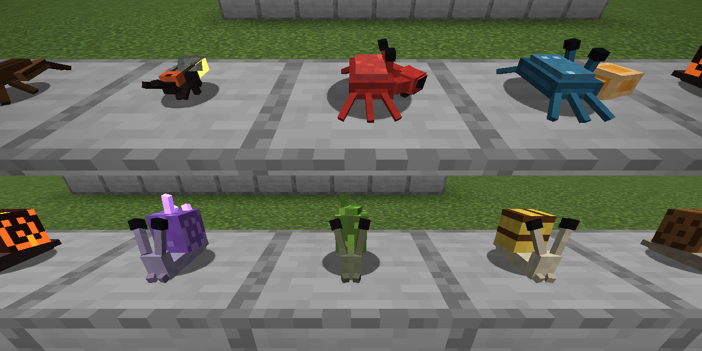
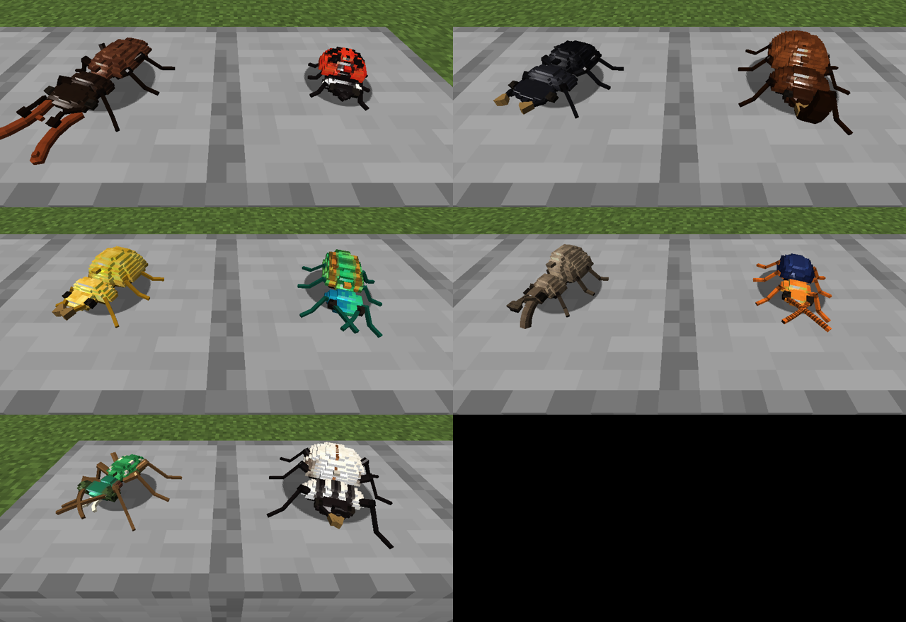
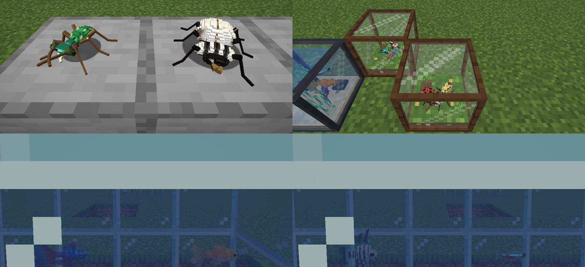
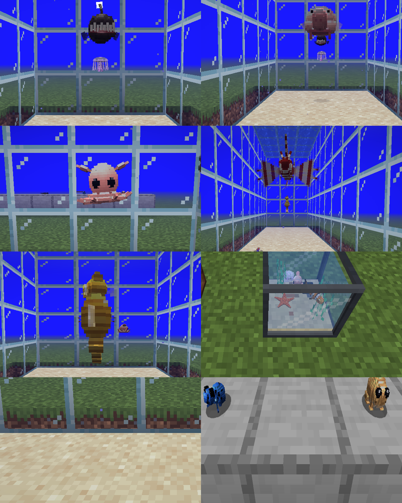

# Critters

A Fabric mod for **Minecraft 1.21.1** that adds 36 small creatures. You catch them in jars and keep them in terrariums and aquariums, so you can build your own zoo.






## The critters

| Group | Critters | Where to find them |
|---|---|---|
| **Snails** (5) | Garden Snail, Banded Snail, Moss Snail, Amethyst Snail, Magma Snail | forests, plains, meadows, swamps, lush/dripstone caves, the Nether |
| **Crabs** (2) | Fiddler Crab, Red Rock Crab | beaches, stony shores, mangrove swamps |
| **Small insects** (3) | Firefly, Cricket, Ant | swamps and forests at night, plains, savannas |
| **Beetles** (10) | Ladybug, Stag Beetle, Rhinoceros Beetle, Dung Beetle, Jewel Beetle, Golden Scarab, Bombardier Beetle, Weevil, Goliath Beetle, Tiger Beetle | flower fields, forests, jungles, deserts, badlands, taigas, beaches |
| **Fish** (4) | Goldfish, Betta Fish, Neon Tetra, Angelfish | rivers, swamps, jungles, mangroves, warm oceans |
| **More fish** (5) | Clownfish, Lionfish, Seahorse, *Blobfish* (ugly), *Anglerfish* (ugly) | warm/lukewarm oceans; blobfish and anglerfish only in the deep ocean |
| **Sea animals** (4) | Moon Jellyfish (glows), *Dumbo Octopus* (cute), Sea Star, Nudibranch | oceans; the dumbo octopus lives in the deep; sea stars and nudibranchs crawl the sea floor |
| **Amphibians** (3) | *Rain Frog* (cute), Poison Dart Frog, Fire Salamander | deserts and beaches, jungles, forests and old-growth taigas |

Behaviour:

* **Snails** crawl slowly and **climb up walls**, turning onto the wall as they go. They leave a glossy **slime trail** on floors and walls, and the trail dries up after about a minute. A snail that gets hurt **hides in its shell** and takes half damage while hiding. The Magma Snail is fire-proof and has glowing cracks. The Amethyst Snail has glowing crystals.
* **Crabs** are amphibious. They breathe underwater, walk along the sea floor and **scuttle sideways** while snipping their claws. The fiddler crab has one giant claw.
* **Fireflies** drift through the air at night and **blink**. **Crickets** hop around on their big back legs. **Ants** run around quickly.
* **Beetles** each have their own look: stag mandibles, a rhinoceros horn, a weevil snout, the dung beetle's shovel head, iridescent jewel colours, and so on.
* **Fish** swim in schools. Neon tetras form big glowing schools, while bettas live alone.

## Animations

Each critter has a walk (or swim/flight), a looping idle and 2–4 special actions it plays now and then
while resting. Critters in terrariums and aquariums perform them too.

| Critter | Walk | Idle | Special actions |
|---|---|---|---|
| Snails (all 5) | shared crawl: foot ripples, head leads | garden: eyestalks retract in turn · banded: head swings, tentacles flick · moss: drowsy, drooping, sprout sways · amethyst: gazes up, stalks twirl · magma: twitchy, shell heaves | look up, taste the ground, stretch, hide in shell (when hurt) |
| Fiddler crab | fast sideways scuttle, big claw carried high | small claw scoops food to its mouth | courtship claw wave, threat display, dig, tuck eyes |
| Red rock crab | sideways scuttle with body roll | claws open and close, eyes swivel | threat display, dig, tuck eyes |
| Firefly | careful crawl · flight with open wing covers | antennae trace circles | triple courtship flash, wing stretch, groom |
| Cricket | walk with pumping jump legs · hops | big slow antenna sweeps | chirp (wings raised, buzzing), clean antenna, look around |
| Ant | quick busy gait, antennae tapping ahead | rapid antenna taps, jaws working | alarm (abdomen raised, jaws open), clean antenna, look around |
| Ladybug | quick scurry | antenna twitches, gentle rock | play dead (flips on its back), groom, push-up |
| Stag beetle | heavy deliberate walk | antlers slowly flex | threat (rears up, antlers wide then snap), groom, look around |
| Rhinoceros beetle | lumbering roll | slow horn nod | horn toss, push-up, look around |
| Dung beetle | head down, high back legs | front legs scrape | dig (with dirt particles), groom, push-up |
| Jewel beetle | smooth glide | wide antenna sweeps | shimmer (tilts to flash its colours), groom, look around |
| Golden scarab | stately, head bobbing | front legs tap in turn | pray (front legs raised), push-up, groom |
| Bombardier beetle | twitchy stop-start | abdomen raised, antennae flicking | spray (abdomen up, puff of smoke), groom, look around |
| Weevil | slow high steps | snout bobbing | drill (snout into the ground), look around, push-up |
| Goliath beetle | heavy giant's walk | breathing, horn sway | rear up waving front legs, push-up, groom |
| Tiger beetle | very fast long strides, stands tall | alert snap turns, jaw clicks | pounce (lunge + snap), look around, groom |
| Goldfish | wide slow tail beats | hovering, pectorals fanning | nibble, dart |
| Betta | flowing undulation | veils billowing | flare (fins and gill covers spread), dart |
| Neon tetra | quick flicks | twitchy bursts | dart, nibble |
| Angelfish | slow glide | trailing filaments sway | banking glide, nibble |
| Clownfish | quick waggle | busy wiggle, buzzing pectorals | wiggle dance, dart, nibble |
| Lionfish | slow hover | huge fans slowly open and close, spines sway | fan display (fins and spines spread), nibble |
| Seahorse | upright drift | dorsal fin a blur, tail coiling and uncoiling | tail curl, bow |
| Blobfish | sluggish | sagging, wobbling "breaths", droopy nose | sigh (deflates and sags), nibble |
| Anglerfish | slow prowl | lure dangles and sways, mouth agape | lure dance (glowing), jaw snap |
| Moon Jellyfish | bell pulses | slow pulsing drift, tentacles trailing | strong pulses, spin |
| Dumbo Octopus | flaps its "ears" | gentle ear flaps, bobbing, arms curling | rapid flap, umbrella (arms flared up) |
| Sea Star | slow tube-foot ripple | arm tips lift one by one | curl up, wave an arm |
| Nudibranch | muscular crawl | horns sway, gill plume breathes | tuck horns, gill flutter |
| Rain Frog | stubby waddle | slow round breathing | puff up into a ball, blink, croak |
| Poison Dart Frog | crawl and hop, kicks while swimming | fast throat breathing | croak (vocal sac), blink, look around |
| Fire Salamander | side-to-side body wave | lazy tail curl, throat pumping | stretch up, tail wag, look around |

## Catching and displaying

| Item / Block | How to use it |
|---|---|
| **Critter Jar** | Use it on any land critter to catch it. You get a jar with that critter in it, which keeps its name and health. Use the filled jar on a block to let the critter go. Released critters never despawn. |
| **Fish and sea animals** | Catch them with a water bucket, like vanilla fish. You get a *Bucket of Goldfish* and so on. This includes jellyfish, octopuses, sea stars and nudibranchs. |
| **Amphibians** | Catch frogs and salamanders with a Critter Jar and keep them in a Terrarium. |
| **Terrarium** | Use a filled jar on it to move the critter inside. It holds 3 critters, which wander around on the moss inside the glass. Fireflies fly around inside. |
| **Aquarium** | Use a fish bucket on it to move the fish inside. It holds 4 fish. It accepts vanilla fish buckets too: cod, salmon, pufferfish and tropical fish, which keep their patterns. |

* Use a terrarium or aquarium with an empty hand to see who lives there.
* **Sneak and use** it with an empty hand to take the last critter back out, in its jar or bucket.
* Breaking the block drops every critter in its jar or bucket, so none are ever lost.

### Recipes

```
Critter Jar (x3)        Terrarium               Aquarium
 . B .                   P G P                   N G N
 G . G                   G . G                   G W G
 G G G                   P D P                   N S N

B = any wooden button   P = any planks          N = iron nugget
G = glass               D = dirt / grass / moss W = water bucket
                                                S = sand
```

Every critter also has a spawn egg. Everything is in the **Critters** creative tab.

## Building

You need Java 21.

```sh
./gradlew build          # mod jar ends up in build/libs/critters-1.0.0.jar
./gradlew runClient      # start a dev client
./gradlew runServer      # start a dev server
```

Install the jar together with [Fabric API](https://modrinth.com/mod/fabric-api) (0.116+ for 1.21.1) and Fabric Loader 0.16+.

## Project layout

```
src/main/java/com/critters/
  CrittersMod.java           mod entry point
  registry/CritterSpecies    the list of all 24 critters (size, health, speed, egg colours)
  registry/Mod*              blocks, items, entities, spawns, creative tab
  entity/                    Snail, Crab, Flying (firefly), Hopping (cricket), base critter, fish
  block/                     Terrarium, Aquarium, the shared display block entity, Slime Trail
  item/CritterJarItem        catching and releasing
src/client/java/com/critters/client/
  model/CritterModel         one animated model class for every critter
  model/CritterLayers        GENERATED dispatcher; model/layers/* GENERATED geometry (do not edit)
  render/                    entity renderer, glow layer, terrarium/aquarium renderer
tools/
  critter_models.py          model geometry + procedural materials for every critter
  shading.py                 numpy noise, material helpers and baked lighting
  model_painter.py           UV packing, 3D texture painting, Java model code generation
  generate_assets.py         runs everything + item/block textures, models, lang, recipes, loot
```

### How the models and textures are made

The critters are authored at 5x vanilla resolution (80 units per block) and drawn at 1/5 scale. That is
where their fine detail comes from.

* **Curvature**: domes, shells, bodies and eyes are stacked, rounded slices that approximate ellipsoids.
* **Anatomy**: legs are jointed (femur, tibia, tarsus) and antennae are segmented chains. Fins and wings
  are flat cards with alpha-cut silhouettes, veins and fin rays.
* **Textures**: every texel is mapped back to the 3D point it covers. Materials are procedural functions
  of that point: noise, cellular patterns, spiral shells, scales, chitin pits and grooves, iridescence,
  lava cracks. Patterns therefore flow seamlessly across all the small cubes.
* **Lighting**: shading uses the smooth normal of the shape each cube approximates, plus specular gloss.
  It also compensates for Minecraft's own per-face entity lighting, so curved surfaces don't look terraced.

### Changing or adding critters

The models and textures are generated together, so the texture UVs always match the model:

1. Edit the critter's shape or colours in `tools/critter_models.py`. For a new critter, also add it to `SPECIES` in `tools/generate_assets.py`, to `CritterSpecies.java` and to `ModSpawns.java`.
2. Run `python3 tools/generate_assets.py`. It needs Pillow and numpy.
3. Run `./gradlew build`.

## License

MIT
